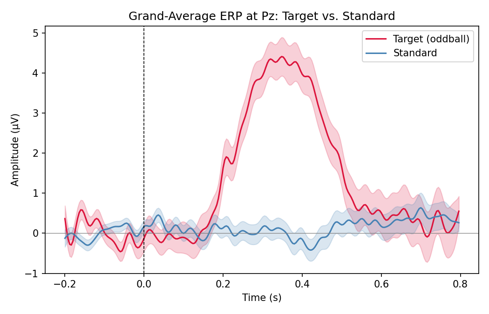
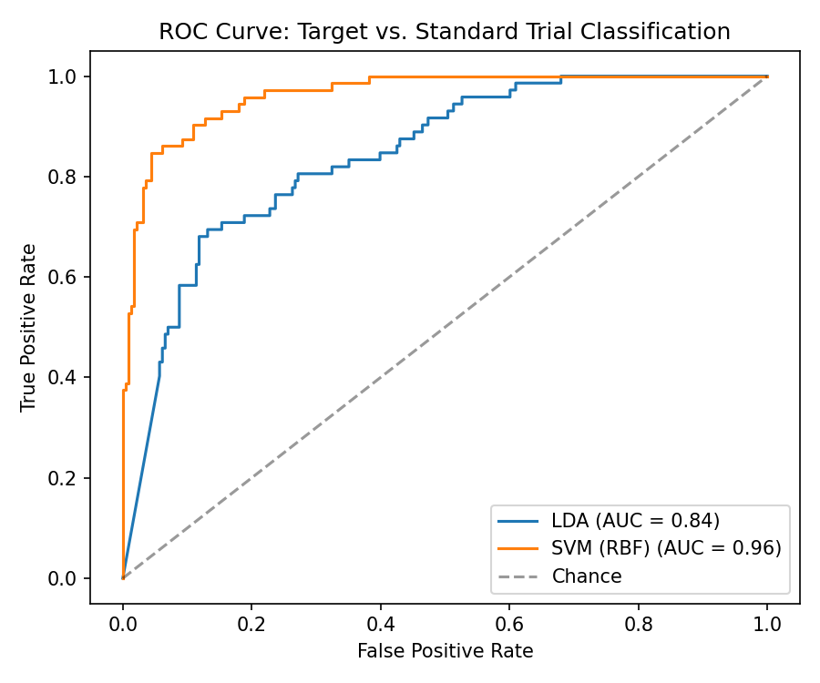

# ERP Signal Analysis & Machine Learning

A machine learning pipeline for detecting P300 event-related potentials (ERPs)
in EEG data, applied to a classic oddball paradigm. Built as part of my
self-directed study of neural signal processing, following concepts from
Mike X Cohen's *Complete Neural Signal Processing and Analysis* course.

## Motivation

The P300 is one of the most well-studied ERP components in neuroscience and
brain-computer interfaces (BCIs) — it's the signal underlying P300 speller
systems and is widely used as a marker of attention and stimulus evaluation.
This project builds a full pipeline, from raw EEG to a trained classifier,
to understand — end to end — how BCI/neurofeedback systems detect this kind
of signal in practice.

## Current status

🚧 **Work in progress.** The pipeline currently runs on physiologically
informed **simulated** EEG data (see `src/simulate_data.py` for details and
rationale). The next milestone is validating the pipeline on real, publicly
available EEG data (see [Roadmap](#roadmap)).

## Pipeline overview

```
simulate_data.py  →  preprocessing.py  →  features.py  →  classify.py
 (raw EEG epochs)     (filter, baseline,     (P300 window        (LDA / SVM,
                       artifact rejection)    + waveform features) cross-validated)
                            ↓
                    visualize_erp.py
                    (grand-average ERP plot)
```

| Step | Script | What it does |
|---|---|---|
| 1 | `src/simulate_data.py` | Generates EEG epochs for an oddball paradigm (target vs. standard trials), with realistic 1/f noise and a jittered P300 waveform |
| 2 | `src/preprocessing.py` | Band-pass filter (0.1–30 Hz), baseline correction, amplitude-based artifact rejection |
| 3 | `src/features.py` | Extracts P300-window mean amplitude and downsampled waveform features |
| 4 | `src/classify.py` | Trains LDA and SVM classifiers with stratified 5-fold cross-validation; plots ROC curve and confusion matrix |
| — | `src/visualize_erp.py` | Plots the grand-average ERP waveform (target vs. standard) at channel Pz |

## Results (on simulated data)

Grand-average ERP showing the expected P300 deflection (~350ms) for target
trials relative to standard trials:



Classifier performance (5-fold cross-validated, stratified for class imbalance):

| Model | ROC AUC |
|---|---|
| LDA | ~0.84 |
| SVM (RBF) | ~0.96 |



*(Numbers are on simulated data and are expected to change once real EEG data
is used — see Roadmap. They demonstrate that the pipeline correctly recovers
a known, designed-in signal, which is the right first check before applying
it to real, noisier data.)*

## Getting started

```bash
pip install numpy scipy scikit-learn matplotlib

python src/simulate_data.py      # generate simulated EEG dataset
python src/preprocessing.py      # filter, baseline-correct, reject artifacts
python src/features.py           # extract classification features
python src/classify.py           # train + evaluate classifiers
python src/visualize_erp.py      # plot grand-average ERP
```

## Using real EEG data (ERP CORE / OpenNeuro)

The pipeline now supports real data via `src/load_real_data.py`, which uses
MNE-Python to load a raw EEG file and converts it into the same array format
produced by `simulate_data.py` — so every downstream step (preprocessing,
features, classification, visualization) runs unchanged.

```bash
pip install mne mne-bids

# 1. Download one subject's P3-task data from ERP CORE: https://osf.io/thsqg/
#    Place sub-001_P3.set (+ .fdt) in data/raw/

# 2. Convert to the pipeline's format
python src/load_real_data.py --file data/raw/sub-001_P3.set

# 3. Run the same pipeline, pointing at the real dataset
python src/preprocessing.py --input data/real_erp_dataset.npz
python src/features.py
python src/classify.py
python src/visualize_erp.py
```

⚠️ Before running, open `src/load_real_data.py` and check
`EVENT_ID_TARGET` / `EVENT_ID_STANDARD` against the actual trigger codes in
your downloaded file (printed automatically when you run the script) — event
codes differ slightly between dataset versions.

## Roadmap

- [x] Support loading a real-world EEG dataset via MNE-Python (`load_real_data.py`)
- [ ] Validate pipeline end-to-end on ERP CORE P3 data (currently only tested on simulated data)
- [ ] Add independent component analysis (ICA) for eye-blink/muscle artifact removal
- [ ] Compare against deep learning baselines (e.g. EEGNet)
- [ ] Evaluate single-trial (rather than averaged) classification accuracy,
      which is what matters for real-time BCI applications
- [ ] Explore Riemannian geometry / xDAWN spatial filtering, standard in
      modern BCI pipelines

## Background / learning resources

This project accompanies my coursework in:
- *Complete Neural Signal Processing and Analysis: Zero to Hero* (Mike X Cohen)

## Author

Ana Kuwakino — Neuroscience student, Arizona State University
[abarrosk@asu.edu](mailto:abarrosk@asu.edu)
